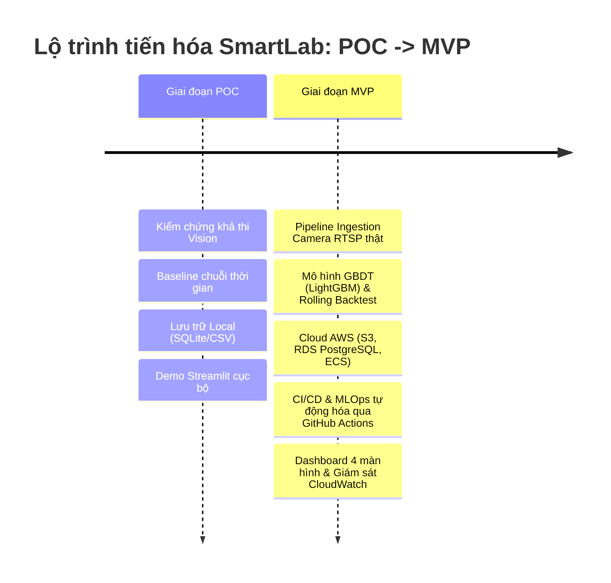
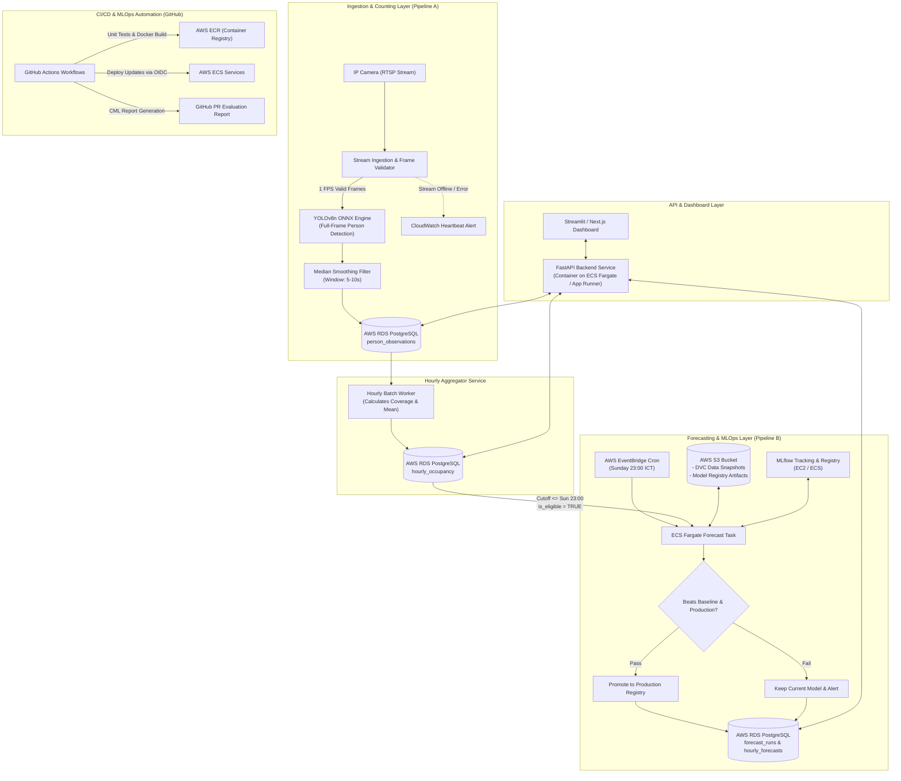
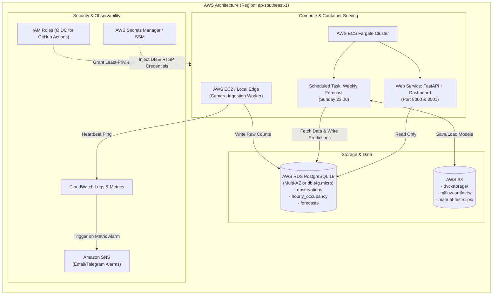
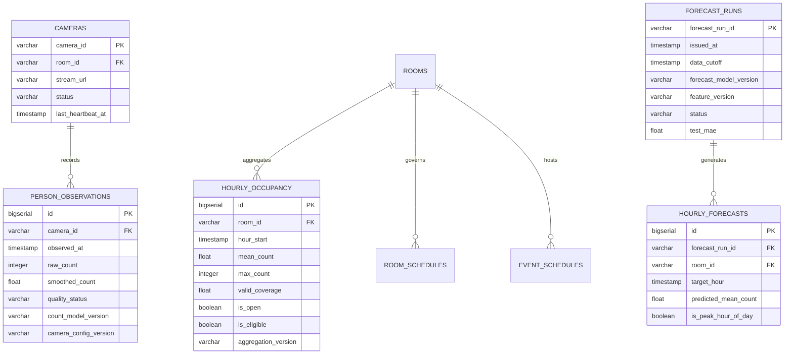
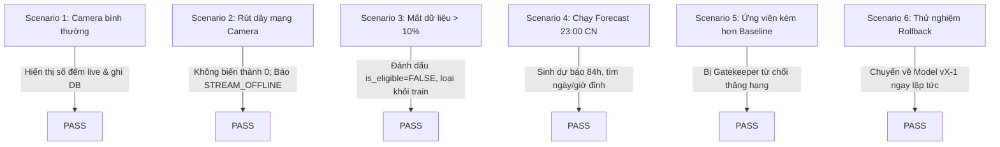

# SmartLab — An MLOps-Based System for Automated People Counting and Room Occupancy Forecasting

[](#ci-cd--mlops-with-github-actions)
[-FF9900?logo=amazon-aws&logoColor=white)](#aws-cloud-infrastructure-integration)
[](#data-management--versioning)
[](#mlops-lifecycle--model-governance)
[](#pipeline-a--computer-vision--data-ingestion)
[](#pipeline-b--time-series-occupancy-forecasting)
[](https://opensource.org/licenses/MIT)

---

## 1. Giới thiệu tổng quan & Tuyên bố bài toán (Problem Statement)

Hệ thống **SmartLab** giải quyết bài toán giám sát, đo lường và dự báo mức độ sử dụng phòng câu lạc bộ (CLB) dựa trên luồng hình ảnh từ một camera cố định. Dữ liệu từ camera được trích xuất thành chuỗi thời gian occupancy lịch sử, từ đó mô hình dự báo học quy luật để đưa ra dự báo mức độ đông theo từng giờ cho tuần tiếp theo. Toàn bộ vòng đời của dữ liệu và hai mô hình học máy độc lập được quản lý chặt chẽ thông qua quy trình **MLOps**, bảo đảm khả năng kiểm thử tự động, triển khai có kiểm soát, giám sát liên tục và rollback tức thời.

### 1.1. Các khái niệm cốt lõi & Quy ước kỹ thuật
* **Occupancy (Số người hiện diện)**: Số lượng người có mặt trong phòng tại một thời điểm lấy mẫu cụ thể. Vì phòng CLB là một **không gian phòng kín (Enclosed Room)**, camera cố định quan sát bao quát toàn phòng nên hệ thống áp dụng cơ chế **Full-Frame Detection (đếm trên toàn bộ khung hình)**, không cần cấu hình đa giác ROI hay lọc điểm neo chân. SmartLab phiên bản đầu tập trung giải quyết bài toán **Occupancy**, không đếm số lượt vào/ra (*Traffic*).
* **Số người trung bình theo giờ (Hourly Mean Occupancy)**: Chia mỗi giờ thành $3.600$ ô 1 giây. Mỗi ô lưu một số đếm hợp lệ sau khi làm mượt.
  $$\text{valid\_coverage} = \frac{\text{Số ô có dữ liệu hợp lệ}}{3.600}$$
  * Giờ đạt chuẩn tính toán/huấn luyện: $\text{valid\_coverage} \ge 90\%$.
  * Giờ có $\text{valid\_coverage} < 90\%$: Đánh dấu thiếu dữ liệu, **loại khỏi tập nhãn huấn luyện**, không được tự ý gán giá trị $0$.
* **Định nghĩa "Giờ đông nhất" & "Ngày đông nhất"**:
  * Giờ đông nhất của một ngày: Giờ hoạt động có số người trung bình ($\text{mean\_count}$) cao nhất.
  * Ngày đông nhất trong tuần: Ngày có giá trị trung bình cộng $\text{mean\_count}$ trên các **giờ mở cửa thực tế** cao nhất (không tính giờ đóng cửa).
* **Chu kỳ phát hành dự báo tuần tới**:
  * Múi giờ chuẩn: `Asia/Ho_Chi_Minh` (UTC+7).
  * Tuần hoạt động: Bắt đầu từ 00:00 Thứ Hai đến 23:59:59 Chủ Nhật.
  * Lịch phát hành dự báo: Định kỳ lúc **23:00 Chủ Nhật** hàng tuần. Chỉ được dùng dữ liệu trước mốc cắt này ($\text{data\_cutoff} \le 23:00$ Chủ Nhật). Tuyệt đối ngăn chặn rò rỉ dữ liệu tương lai (*Data Leakage*).

---

## 2. Lộ trình phát triển: POC đến MVP (Roadmap & Requirements)



### 2.1. Bảng so sánh phạm vi: POC vs. MVP

| Tiêu chí | Giai đoạn 1: POC (Proof of Concept) | Giai đoạn 2: MVP (Minimum Viable Product) |
| :--- | :--- | :--- |
| **Mục tiêu cốt lõi** | Kiểm chứng tính khả thi của thuật toán đếm người trên video mẫu và baseline dự báo. | Xây dựng hệ thống tự động hoàn chỉnh, chịu lỗi, có MLOps chuẩn mực triển khai trên AWS và CI/CD GitHub. |
| **Nguồn dữ liệu Camera** | Đọc video clip có sẵn (`.mp4`) hoặc snapshot giả lập. | Kết nối luồng RTSP camera thật 24/7, xử lý sampling 1 FPS, giải mã và phát hiện lỗi khung hình. |
| **Xử lý thị giác máy tính** | YOLOv8n pretrained, đếm trên toàn khung hình phòng kín. | YOLOv8n tối ưu với ONNX Runtime/TensorRT, đếm Full-Frame phòng kín, bộ lọc nhiễu trung vị (Median Filter). |
| **Mô hình dự báo** | Baseline: Cùng giờ tuần trước (Same-Hour Last Week) & Trung bình 4 tuần gần nhất. | LightGBM / XGBoost có Feature Engineering (Lịch, Lag, Rolling stats), tự động so sánh với Baseline qua Rolling Backtest. |
| **Lưu trữ dữ liệu** | File CSV nội bộ hoặc SQLite cục bộ. | Cơ sở dữ liệu quan hệ **AWS RDS PostgreSQL** chuẩn hóa schema 3NF; DVC lưu trữ snapshots trên **AWS S3**. |
| **MLOps & Tracking** | Git local commits; logging metric thủ công hoặc local MLflow instance. | **MLflow Model Registry** (Candidate $\to$ Validated $\to$ Production), automated gating, DVC data versioning, Rollback an toàn. |
| **Tích hợp GitHub** | Quản lý source code đơn thuần. | **GitHub Actions CI/CD**: Linting, Unit Testing, Docker build & push lên AWS ECR, CML Report tự động trên Pull Request. |
| **Hạ tầng Cloud** | Máy trạm cục bộ (Local Developer Machine). | **AWS Cloud Infrastructure**: EC2/Edge Worker, ECS Fargate Scheduled Tasks, S3, RDS, CloudWatch Alarms, SNS. |
| **Dashboard** | Streamlit giao diện đơn giản hiển thị số đếm và biểu đồ cơ bản. | Dashboard 4 phân hệ hoàn chỉnh (Live Status, Historical Trends, Next-Week Forecasts, MLOps Operations & Rollback). |

---

### 2.2. Chi tiết yêu cầu Giai đoạn POC (Proof of Concept)
> 📋 **Kế hoạch triển khai chi tiết từng Issue**: Xem toàn bộ 8 Issues/Tickets kỹ thuật tại [`documentations/POC_PLAN.md`](documentations/POC_PLAN.md).

#### Mục tiêu
Chứng minh rằng: (1) Mô hình Object Detection có thể nhận diện chính xác người trong phòng kín trên video mẫu với sai số chấp nhận được; (2) Dữ liệu số đếm có thể tổng hợp thành chuỗi thời gian hourly occupancy và dự báo sơ bộ bằng baseline.

#### Danh mục 8 Issues kỹ thuật của POC (Sprint 2 tuần)
* `[POC-01]` Thu thập dữ liệu video mẫu & Khảo sát góc nhìn phòng kín.
* `[POC-02]` Xây dựng tập kiểm thử Ground Truth 50 frames gán nhãn thủ công.
* `[POC-03]` Module Ingestion & Nhận diện người Full-Frame (YOLOv8n).
* `[POC-04]` Bộ lọc làm mượt trung vị & Tổng hợp Hourly Occupancy (ngưỡng 90% coverage).
* `[POC-05]` Đánh giá định lượng mô hình đếm (Count MAE $\le 1.8$ người & Error Analysis).
* `[POC-06]` Mô hình dự báo Baseline (Last Week & Rolling Mean, cutoff 23:00 Chủ Nhật).
* `[POC-07]` Dashboard tương tác POC (Streamlit Local UI 3 tabs).
* `[POC-08]` Báo cáo nghiệm thu POC & Tiêu chuẩn chuyển giao lên MVP.

#### Yêu cầu chức năng cốt lõi
1. **Video Ingestion & Detection**:
   * Đọc video clip test độ dài 15–30 phút (`.mp4`, 1080p, 25/30 fps).
   * Lấy mẫu 1 khung hình/giây (1 FPS).
   * Áp dụng mô hình `yolov8n.pt` phát hiện class `person` với ngưỡng `conf >= 0.35` trên toàn bộ khung hình phòng kín.
2. **Data Aggregation**:
   * Tính trung vị số đếm trong cửa sổ trượt 5 giây để khử rung nhiễu.
   * Tính mean count theo từng block 15 phút và 1 giờ, xuất ra file `data/poc_hourly_occupancy.csv`.
3. **Baseline Forecasting**:
   * Xây dựng script `poc_baseline.py` dự báo cho 24 giờ tiếp theo:
     * *Baseline 1*: Lấy giá trị của cùng khung giờ ngày hôm trước hoặc tuần trước.
     * *Baseline 2*: Trung bình động 3 chu kỳ gần nhất.
4. **Evaluation**:
   * Gán nhãn thủ công (Ground Truth) cho 50 frames ngẫu nhiên phân bổ ở cả cảnh vắng ($< 5$ người) và cảnh đông ($> 15$ người).
   * Tính toán chỉ số $\text{Count MAE} = \frac{1}{N} \sum |y_{pred} - y_{true}|$.
5. **Definition of Done (DoD) của POC**:
   * Code chạy được end-to-end từ video $\to$ bảng số liệu CSV $\to$ biểu đồ baseline.
   * Báo cáo thử nghiệm chứng minh $\text{Count MAE} \le 1.8$ người trên tập 50 frames test.
   * Giao diện Streamlit POC chạy local hiển thị được video có vẽ bounding box người trong phòng và đồ thị chuỗi thời gian.

---

### 2.3. Chi tiết yêu cầu Giai đoạn MVP (Minimum Viable Product)
> 📋 **Kế hoạch triển khai chi tiết từng Issue**: Xem toàn bộ 13 Issues/Tickets kỹ thuật tại [`documentations/MVP_PLAN.md`](documentations/MVP_PLAN.md).

#### Mục tiêu
Xây dựng một hệ thống hoàn chỉnh, sẵn sàng vận hành thực tế tại phòng CLB, có khả năng tự phục hồi, giám sát sai số liên tục, triển khai tự động hóa qua GitHub Actions lên môi trường AWS.

#### Danh mục 13 Issues kỹ thuật của MVP (Sprint 5 tuần)
* `[MVP-01]` Thiết lập Hạ tầng AWS (Terraform, S3, RDS, ECS, OIDC).
* `[MVP-02]` Thiết kế Database Schema & Migration (PostgreSQL & Alembic).
* `[MVP-03]` RTSP Stream Ingestion & Resilient Camera Worker (Auto-reconnect & Heartbeat).
* `[MVP-04]` Full-Frame Detection Engine (YOLOv8n ONNX) & Median Filter.
* `[MVP-05]` Data Aggregator: Tổng hợp Hourly Occupancy & Ngưỡng 90% coverage.
* `[MVP-06]` Data Management & Versioning với DVC & AWS S3 Remote.
* `[MVP-07]` Feature Engineering chống rò rỉ dữ liệu (Cutoff nghiêm ngặt 23:00 Chủ Nhật).
* `[MVP-08]` Huấn luyện LightGBM & Framework Rolling Backtest (4 tuần quá khứ).
* `[MVP-09]` MLflow Model Registry & Automated Gatekeeper (Promotion Rule).
* `[MVP-10]` Synchronized Safe Rollback Engine ($\le 30$ giây).
* `[MVP-11]` CI/CD & MLOps Workflows trên GitHub Actions (CML & OIDC).
* `[MVP-12]` Dashboard 4 phân hệ & API Serving (FastAPI + Streamlit).
* `[MVP-13]` Nghiệm thu 6 Kịch bản Bắt buộc & Bàn giao Hệ thống.

#### Yêu cầu chức năng chi tiết
1. **Pipeline A — Camera Worker & Stream Ingestion**:
   * Kết nối luồng RTSP của Camera với cơ chế tự động kết nối lại (Exponential Backoff Reconnect).
   * Kiểm tra tính toàn vẹn của khung hình (Frame Decoding Check, Stale Timestamp Check).
   * Khi mất kết nối hoặc hình ảnh lỗi: Ghi nhận trạng thái `quality_status = 'STREAM_OFFLINE'` hoặc `'CORRUPTED'`, **tuyệt đối không ghi số 0 vào CSDL**.
   * Phát hiện người bằng `YOLOv8n ONNX Runtime` chạy trên CPU/GPU trên toàn bộ khung hình phòng kín (Full-Frame Detection).
   * Làm mượt số đếm thời gian thực bằng Moving Median window (5–10 giây).
   * Lưu từng bản ghi quan sát vào bảng `person_observations`.
   * Worker định kỳ mỗi 60 phút tổng hợp dữ liệu vào bảng `hourly_occupancy`, áp dụng ngưỡng $90\%$ coverage để xác định cờ `is_eligible`.
2. **Pipeline B — Automated Weekly Forecasting**:
   * Tự động kích hoạt lúc **23:00 Chủ Nhật hàng tuần** (`Asia/Ho_Chi_Minh`) qua AWS EventBridge / GitHub Actions cron.
   * Áp dụng `data_cutoff = 23:00 Chủ Nhật`. Chỉ truy vấn các dòng có `is_eligible = TRUE` và `observed_at <= data_cutoff`.
   * Tạo bảng đặc trưng (Feature Matrix):
     * *Temporal features*: `hour_of_day`, `day_of_week`, `is_weekend`, `month`.
     * *Calendar features*: `is_club_open` (theo lịch cấu hình), `event_type` (từ lịch sự kiện đã biết trước mốc cutoff).
     * *Lag & Rolling statistics*: Occupancy cùng giờ tuần trước, trung bình 2 tuần và 4 tuần trước, tỷ lệ thiếu dữ liệu lịch sử.
   * Huấn luyện mô hình GBDT (`LightGBM Regressor`).
   * Thực hiện Rolling Backtest trên 4 tuần gần nhất để đối chiếu với 2 Baseline.
   * Dự báo 84 khung giờ (hoặc toàn bộ giờ hoạt động trong tuần tới), tính toán:
     * Occupancy trung bình dự báo từng giờ.
     * Xác định **Ngày đông nhất** trong tuần.
     * Xác định **Khung giờ đông nhất** cho từng ngày.
   * Ghi kết quả vào bảng `forecast_runs` và `hourly_forecasts`.
3. **MLOps Layer & Governance**:
   * Quản lý phiên bản dữ liệu bằng **DVC** kết hợp **AWS S3 Bucket**.
   * Quản lý vòng đời mô hình bằng **MLflow Tracking & Model Registry**:
     * Trạng thái: `Candidate` $\to$ `Validated` $\to$ `Production` $\to$ `Retired`.
     * Quản lý riêng biệt phiên bản mô hình đếm (`count_model_vX.Y`) và mô hình dự báo (`forecast_model_vX.Y`).
   * **Automated Deployment Gatekeeper**: Mô hình Candidate chỉ được thăng hạng lên `Production` khi và chỉ khi:
     $$\text{MAE}_{\text{Candidate}} < \text{MAE}_{\text{Production}} \quad \text{và} \quad \text{Peak Hour Accuracy} \ge \text{Baseline}$$
   * **Cơ chế Rollback an toàn**: Cho phép chuyển đổi ngược lại phiên bản Production trước đó chỉ bằng 1 thao tác (GitHub Actions Dispatch hoặc API endpoint) mà không làm mất lịch sử lỗi hay dự báo cũ.
4. **Dashboard & Trải nghiệm người dùng (4 Phân hệ)**:
   * **Màn hình 1 — Live Status**: Số người hiện diện hiện tại, thời điểm cập nhật cuối, trạng thái camera (Online/Offline), độ mới dữ liệu (Freshness indicator).
   * **Màn hình 2 — Lịch sử sử dụng phòng**: Biểu đồ chuỗi thời gian occupancy theo giờ/ngày/tuần; hiển thị rõ ranh giới giữa giờ đóng cửa và giờ bị mất tín hiệu camera.
   * **Màn hình 3 — Dự báo tuần tới**: Bảng Heatmap 7 ngày x 24 giờ; làm nổi bật Ngày đông nhất tuần và Giờ cao điểm từng ngày; hiển thị thời điểm phát hành dự báo và cảnh báo khi dùng mô hình fallback.
   * **Màn hình 4 — Vận hành kỹ thuật (MLOps Operations)**: Xem phiên bản mô hình đang phục vụ, lịch sử so sánh metric của các run thử nghiệm, logs cảnh báo pipeline, nút kích hoạt Manual Re-run hoặc Rollback.
5. **Definition of Done (DoD) của MVP**:
   * Hệ thống vận hành liên tục tối thiểu 7 ngày trên môi trường AWS.
   * CI/CD trên GitHub Actions tự động kiểm thử và deploy thành công khi merge vào nhánh `main`.
   * Vượt qua toàn bộ 6 kịch bản kiểm thử bắt buộc (xem Mục 6).

---

### 2.4. Chính sách huấn luyện lại mô hình (Retraining Policy)

Hệ thống SmartLab phân tách độc lập và kiểm soát chặt chẽ cơ chế retrain giữa hai mô hình:

```mermaid
flowchart TD
    subgraph Retrain_Pipeline_B["Pipeline B: Mô hình Dự báo (LightGBM)"]
        CronSun["23:00 Chủ Nhật hàng tuần"] --> CheckData["Dữ liệu tuần mới đạt valid_coverage >= 90%?"]
        CheckData -->|Có| TrainCand["Huấn luyện mô hình Candidate mới"]
        CheckData -->|Không| SkipB["Bỏ qua retrain, dùng Production hiện tại"]
        TrainCand --> Backtest["Rolling Backtest 4 tuần đối đầu Production"]
        Backtest --> Gate{"MAE_candidate < MAE_prod & PeakAcc >= Baseline?"}
        Gate -->|Đạt| PromoteProd["Thăng hạng tag 'Production'"]
        Gate -->|Không đạt| RejectCand["Từ chối thăng hạng & gửi alert SNS"]
    end

    subgraph Retrain_Pipeline_A["Pipeline A: Mô hình Đếm người (YOLOv8n)"]
        Drift["Phát hiện Data/Concept Drift hoặc đổi góc camera"] --> Audit["Kiểm tra thủ công: Count MAE > 1.8 người?"]
        Audit -->|Có| HumanLabel["Con người gán nhãn thủ công tập ảnh mới"]
        Audit -->|Không| KeepA["Giữ nguyên mô hình hiện tại"]
        HumanLabel --> DVC_Snap["Lưu snapshot nhãn qua DVC + S3"]
        DVC_Snap --> FineTune["Fine-tune YOLOv8n có kiểm soát"]
        FineTune --> ManualPromote["Đánh giá & Phê duyệt lên Production"]
    end
```



1. **Pipeline B (Mô hình Dự báo chuỗi thời gian)**: **CÓ RETRAIN ĐỊNH KỲ HÀNG TUẦN**.
   * Chạy tự động vào 23:00 Chủ Nhật khi có snapshot dữ liệu tuần mới đạt `is_eligible = True`.
   * Mô hình sau khi retrain chỉ ở trạng thái `Candidate`, bắt buộc vượt qua cổng kiểm duyệt `Automated Gatekeeper` (so sánh Rolling Backtest với Production và Baseline) mới được thăng hạng.
2. **Pipeline A (Mô hình Đếm người Computer Vision)**: **KHÔNG RETRAIN TỰ ĐỘNG MÙ QUÁNG**.
   * Chỉ retrain/fine-tune theo nhu cầu (On-Demand / Drift-Triggered) khi có sự thay đổi vật lý trong phòng (kê lại bàn ghế, đổi camera, đổi ánh sáng) hoặc sai số trên tập kiểm tra định kỳ vượt ngưỡng ($\text{Count MAE} > 1.8$ người).
   * Bắt buộc có con người gán nhãn thủ công (Human-in-the-loop) để đảm bảo độ tin cậy của Ground Truth.
3. **Nguyên tắc "Không retrain chỉ vì phân phối số người thay đổi"**:
   * Khi phòng CLB đột ngột đông bất thường (do tổ chức Workshop, giải đấu), hệ thống không được vội vàng đưa vào retrain vì sẽ làm biến dạng quy luật chuỗi thời gian bình thường. Cần xác minh nguyên nhân ngoại cảnh trước khi đưa vào tập huấn luyện.

---

## 3. Kiến trúc hệ thống tổng thể (System Architecture)



---

## 4. Công nghệ sử dụng & Tích hợp AWS & GitHub (Tech Stack & Integrations)

### 4.1. Bảng công nghệ chi tiết (Detailed Tech Stack)

| Tầng chức năng | Công nghệ lựa chọn | Mục đích sử dụng |
| :--- | :--- | :--- |
| **Core Language** | **Python 3.11** | Ngôn ngữ chuẩn hóa cho toàn bộ backend, data pipelines và ML scripts. |
| **Computer Vision** | **OpenCV, Ultralytics YOLOv8n, ONNX Runtime** | Thu nhận RTSP stream, phát hiện người thời gian thực trên toàn bộ khung hình phòng kín. |
| **Data Processing & ML** | **Pandas, NumPy, Scikit-learn, LightGBM, Statsmodels** | Xử lý chuỗi thời gian, trích xuất đặc trưng chu kỳ/trễ, huấn luyện mô hình GBDT, tính rolling backtest. |
| **Backend & API** | **FastAPI, Pydantic v2, SQLAlchemy 2.0, Alembic** | Xây dựng RESTful API hiệu năng cao, xác thực dữ liệu, quản lý migration CSDL quan hệ. |
| **Database** | **PostgreSQL 16 (AWS RDS)** | Lưu trữ bền vững dữ liệu quan sát thô, số liệu tổng hợp theo giờ và lịch sử dự báo. |
| **MLOps & Experiment Tracking**| **MLflow 2.x, DVC (Data Version Control)** | Quản lý vòng đời mô hình, log metrics thử nghiệm, version hóa dữ liệu ảnh mẫu và dataset trên cloud. |
| **CI/CD & DevOps** | **GitHub Actions, Docker, Docker Compose, CML (Iterative)** | Tự động hóa build, test, push container image, báo cáo đánh giá mô hình trực tiếp trên PR. |
| **Frontend Dashboard** | **Streamlit** (hoặc **Next.js + TailwindCSS**) | Giao diện trực quan hóa dữ liệu 4 màn hình phục vụ cả người quản trị CLB và kỹ sư vận hành. |
| **Cloud Infrastructure** | **AWS Cloud (S3, RDS, ECS Fargate, ECR, CloudWatch, SNS, IAM OIDC)** | Hạ tầng đám mây tin cậy, bảo mật và có khả năng mở rộng linh hoạt. |

---

### 4.2. Tích hợp sâu với GitHub (GitHub Integration)

Hệ thống tận dụng tối đa hệ sinh thái của GitHub để thiết lập quy trình DevOps và MLOps hoàn toàn tự động:

1. **GitHub Repository Structure**:
   * Quản lý mã nguồn theo mô hình Trunk-Based Development hoặc GitHub Flow với bảo vệ nhánh `main`.
   * Quản lý metadata cấu hình: `config/camera_config.json`, `config/schedule.json`.
2. **GitHub Actions CI/CD Pipeline (`.github/workflows/ci-cd.yml`)**:
   * **Trigger**: Tự động kích hoạt khi có Push hoặc Pull Request vào nhánh `main`.
   * **Job 1: Code Quality & Security**:
     * Kiểm tra định dạng và quy chuẩn code bằng `ruff` và `black`.
     * Kiểm tra kiểu tĩnh với `mypy`.
     * Quét lỗ hổng bảo mật dependency với `safety` hoặc `pip-audit`.
   * **Job 2: Automated Testing**:
     * Chạy toàn bộ unit tests và integration tests bằng `pytest` với coverage tối thiểu $\ge 80\%$.
     * Kiểm tra tính toàn vẹn của logic nhận diện Full-Frame và thuật toán tổng hợp ngưỡng $90\%$.
   * **Job 3: Container Build & Push**:
     * Build Docker images tối ưu hóa đa tầng (multi-stage builds) cho Camera Worker, Forecast Worker và Dashboard.
     * Sử dụng **GitHub OIDC** để xác thực với AWS mà **không cần lưu trữ AWS Access Key tĩnh**.
     * Đẩy container images lên **AWS ECR** (Elastic Container Registry) có gắn tag commit SHA và semantic version.
   * **Job 4: Deployment**:
     * Cập nhật Task Definitions mới lên **AWS ECS Fargate** / App Runner.
3. **GitHub Actions MLOps & CML Pipeline (`.github/workflows/model-eval.yml`)**:
   * **CML (Continuous Machine Learning)**: Khi có Pull Request thay đổi mô hình hoặc dữ liệu, workflow sẽ tự động:
     * Kéo snapshot dữ liệu mới nhất từ AWS S3 thông qua DVC.
     * Chạy backtest so sánh mô hình Candidate với Production.
     * Tự động sinh biểu đồ Residuals, đường cong sai số MAE và biểu đồ so sánh Peak Hour.
     * **Comment trực tiếp báo cáo Markdown kèm hình ảnh vào PR** để reviewer có đầy đủ cơ sở phê duyệt.

```yaml
# Ví dụ cấu hình GitHub OIDC kết nối AWS không cần secret key
name: Build and Push to AWS ECR
on:
  push:
    branches: [ main ]
jobs:
  deploy:
    runs-on: ubuntu-latest
    permissions:
      id-token: write
      contents: read
    steps:
      - uses: actions/checkout@v4
      - name: Configure AWS Credentials via OIDC
        uses: aws-actions/configure-aws-credentials@v4
        with:
          role-to-assume: arn:aws:iam::123456789012:role/GitHubActionsSmartLabRole
          aws-region: ap-southeast-1
      - name: Login to Amazon ECR
        id: login-ecr
        uses: aws-actions/amazon-ecr-login@v2
      - name: Build, tag, and push image to Amazon ECR
        env:
          ECR_REGISTRY: ${{ steps.login-ecr.outputs.registry }}
          IMAGE_TAG: ${{ github.sha }}
        run: |
          docker build -t $ECR_REGISTRY/smartlab-forecast:$IMAGE_TAG -f docker/Dockerfile.forecast .
          docker push $ECR_REGISTRY/smartlab-forecast:$IMAGE_TAG
```

---

### 4.3. Tích hợp sâu với Amazon Web Services (AWS Integration)



1. **AWS S3 (Simple Storage Service)**:
   * Bucket `smartlab-mlops-artifacts-<account-id>` chia prefix rõ ràng:
     * `dvc-storage/`: Remote storage lưu trữ các version data snapshots và manual labeled evaluation frames.
     * `mlflow-artifacts/`: Lưu trữ các file artifact của mô hình (`model.onnx`, `lightgbm_model.pkl`, feature importance plots).
     * `error-samples/`: Lưu trữ các frame bị lỗi/che khuất nhằm phục vụ gán nhãn lại (Retraining).
2. **AWS RDS (Relational Database Service) - PostgreSQL 16**:
   * Triển khai PostgreSQL instance (ví dụ `db.t4g.micro` cho môi trường dev/free tier hoặc `db.t4g.small` Multi-AZ cho production).
   * Lưu trữ toàn bộ dữ liệu giao dịch: quan sát theo giây, tổng hợp theo giờ, các lần chạy dự báo và cấu hình phòng.
3. **AWS ECS Fargate (Elastic Container Service)**:
   * **Weekly Forecasting Scheduled Task**: Định cấu hình EventBridge rule chạy task ECS Fargate lúc 23:00 Chủ Nhật. Khởi động container, thực hiện feature engineering, rolling backtest, ghi dự báo và tắt container để tối ưu chi phí.
   * **Web API & Dashboard Service**: Chạy container dịch vụ FastAPI và Dashboard liên tục, kết nối qua Application Load Balancer (ALB).
4. **AWS CloudWatch & Amazon SNS (Monitoring & Alerting)**:
   * **Heartbeat Alarm**: Camera worker gửi heartbeat metric lên CloudWatch mỗi phút. Nếu thiếu 3 chu kỳ liên tiếp ($> 3$ phút), CloudWatch Alarm sẽ kích hoạt SNS gửi thông báo đến ban quản trị CLB qua Email/Telegram.
   * **Data Drift / Coverage Alarm**: Cảnh báo khi một ngày có quá $3$ giờ bị đánh dấu thiếu dữ liệu ($\text{valid\_coverage} < 90\%$).
5. **AWS Secrets Manager & IAM Roles**:
   * Quản lý tập trung chuỗi kết nối Database, mật khẩu RTSP Camera và token dịch vụ.
   * Phân quyền IAM theo nguyên tắc đặc quyền tối thiểu (Least Privilege).

---

## 5. Thiết kế CSDL & Schema Data (Database Design)

CSDL được thiết kế chuẩn hóa trên PostgreSQL để phục vụ trơn tru cả 2 pipeline:



### Chi tiết các trường dữ liệu quan trọng:
* `person_observations`:
  * `raw_count`: Số người thô mô hình đếm được trên toàn khung hình tại frame lấy mẫu.
  * `smoothed_count`: Số người sau bộ lọc trung vị (Median Filter).
  * `quality_status`: Trạng thái khung hình (`VALID`, `FRAME_DECODE_ERROR`, `STALE_DATA`, `CAMERA_OFFLINE`). Nếu lỗi, `raw_count` và `smoothed_count` nhận giá trị `NULL`.
* `hourly_occupancy`:
  * `hour_start`: Thời điểm bắt đầu giờ (ví dụ: `2026-11-09 08:00:00+07`).
  * `valid_coverage`: Tỷ lệ phần trăm ô hợp lệ trong giờ ($[0.0, 1.0]$).
  * `is_eligible`: Cờ boolean đánh dấu giờ này có hợp lệ để đưa vào huấn luyện hay không (bắt buộc `valid_coverage >= 0.90` và `is_open = TRUE`).
* `forecast_runs`:
  * `forecast_run_id`: Định danh duy nhất cho mỗi đợt chạy dự báo (ví dụ: `fcr_20261109_230000`).
  * `data_cutoff`: Giới hạn thời gian dữ liệu được phép sử dụng (ngăn rò rỉ dữ liệu).

---

## 6. Tiêu chí đánh giá mô hình & Nghiệm thu (Acceptance Criteria)

### 6.1. Metric đánh giá mô hình đếm người (Pipeline A)
Đánh giá trên tập dữ liệu kiểm thử được gán nhãn thủ công (ít nhất 100 khung hình/đoạn clip bao phủ đa dạng điều kiện ánh sáng, góc nghiêng và mật độ người):
1. **Count MAE (Mean Absolute Error)**:
   $$\text{Count MAE} = \frac{1}{N} \sum_{i=1}^N \left| \hat{y}_i - y_i \right| \quad (\text{Mục tiêu: } \le 1.2 \text{ người})$$
2. **Crowded Scene MAE**:
   Sai số tuyệt đối trung bình trên các khung hình có trên 15 người $(\text{Mục tiêu: } \le 2.0 \text{ người})$.
3. **Inference Latency & FPS**:
   Thời gian xử lý 1 khung hình $\le 80\text{ms}$ trên CPU hoặc $\le 20\text{ms}$ trên GPU.

### 6.2. Metric đánh giá mô hình dự báo (Pipeline B)
Đánh giá qua **Rolling Backtest** trên tối thiểu 4 tuần quá khứ độc lập:
1. **Hourly MAE**:
   $$\text{MAE}_{\text{hourly}} = \frac{1}{M} \sum_{j=1}^M \left| \hat{O}_j - O_j \right|$$
   *(Chỉ tính toán trên các giờ có `is_eligible = TRUE`)*.
2. **Peak Hour Accuracy (Độ đúng giờ cao điểm)**:
   Tỷ lệ ngày chọn chính xác giờ có số người trung bình cao nhất thực tế.
3. **Peak Hour $\pm 1$ Hour Accuracy**:
   Tỷ lệ ngày chọn giờ cao điểm dự báo cách đỉnh thực tế không quá 1 giờ.
4. **Peak Regret**:
   Mức chênh lệch giữa số người trung bình thực tế tại đỉnh thật và số người thực tế tại giờ mà mô hình chọn:
   $$\text{Peak Regret} = O_{\text{actual\_peak}} - O_{\text{predicted\_peak}}$$
   *(Mục tiêu: $\text{Peak Regret} \le 1.5$ người)*.

---

### 6.3. Sáu kịch bản bắt buộc Demo (Mandatory Demo Scenarios)

Hệ thống MVP chỉ được coi là hoàn thiện khi vượt qua đầy đủ 6 kịch bản thực nghiệm sau:



1. **Kịch bản 1: Vận hành bình thường (Normal Operation)**:
   Camera hoạt động ổn định, hệ thống đếm người trên toàn bộ khung hình phòng kín, làm mượt và cập nhật số người hiện diện lên dashboard mỗi 5 giây; sau 60 phút tổng hợp đầy đủ 1 bản ghi vào `hourly_occupancy`.
2. **Kịch bản 2: Camera mất kết nối (Camera Disconnect Handling)**:
   Ngắt luồng camera mô phỏng. Dashboard lập tức hiển thị trạng thái `CAMERA OFFLINE` kèm thời điểm cập nhật cuối; **tuyệt đối không hiển thị 0 người** và không ghi số 0 vào database.
3. **Kịch bản 3: Xử lý khoảng thiếu dữ liệu (Missing Data Handling)**:
   Mô phỏng mất tín hiệu camera 15 phút trong khung giờ (độ phủ chỉ đạt $75\% < 90\%$). Giờ đó tự động bị gán `is_eligible = FALSE` và bị loại khỏi tập huấn luyện mô hình dự báo.
4. **Kịch bản 4: Kích hoạt dự báo tuần mới (Scheduled Forecast Execution)**:
   Chạy job dự báo với mốc cutoff 23:00 Chủ Nhật. Kết quả dự báo 84 giờ tuần kế tiếp được lưu vào CSDL; Dashboard hiển thị bảng Heatmap, chỉ ra chính xác Ngày đông nhất và Giờ cao điểm từng ngày.
5. **Kịch bản 5: Ngăn chặn triển khai mô hình kém (Model Deployment Gatekeeping)**:
   Huấn luyện một mô hình thử nghiệm bị underfitting hoặc overfitting. Pipeline kiểm thử tự động so sánh metric với Baseline và Production hiện tại, **từ chối chuyển trạng thái sang Production** và ghi lại báo cáo giải trình.
6. **Kịch bản 6: Khôi phục phiên bản an toàn (Safe Rollback)**:
   Kích hoạt lệnh Rollback thông qua GitHub Actions / CLI. Hệ thống tự động phục hồi đồng bộ: artifact mô hình cũ, cấu hình tạo đặc trưng và version tiền xử lý mà không làm gián đoạn API serving hay xóa lịch sử dự báo cũ.

---

## 7. Cấu trúc thư mục dự án (Project Directory Layout)

```text
/workspace/projects/devops/
├── .github/
│   └── workflows/
│       ├── ci-cd.yml             # CI/CD: Lint, Unit test, Docker build & push ECR
│       └── model-eval.yml        # MLOps: Rolling backtest & CML report on PR
├── config/
│   ├── camera_config.json        # Cấu hình camera & thông số phòng kín
│   ├── schedule.json             # Lịch mở/đóng cửa và sự kiện phòng CLB
│   └── model_config.yaml         # Hyperparameters của YOLO và LightGBM
├── data/                         # Quản lý bởi DVC (không commit file lớn lên Git)
│   ├── sample_frames/            # 100 frames gán nhãn thủ công để test
│   └── snapshots/                # Các bản snapshot chuỗi thời gian occupancy
├── docker/
│   ├── Dockerfile.worker         # Container cho Pipeline A (Camera Ingestion)
│   ├── Dockerfile.forecast       # Container cho Pipeline B (Batch Forecast)
│   └── Dockerfile.dashboard      # Container cho FastAPI Backend & Dashboard
├── src/
│   ├── __init__.py
│   ├── vision/                   # PIPELINE A: Vision & Ingestion
│   │   ├── stream_reader.py      # Đọc RTSP, retry, decode checks
│   │   ├── detector.py           # YOLOv8n ONNX Full-Frame inference
│   │   └── smoother.py           # Median filter & rolling window smoother
│   ├── aggregator/               # BATCH AGGREGATOR
│   │   └── hourly_aggregator.py  # Tổng hợp hourly occupancy & tính coverage
│   ├── forecasting/              # PIPELINE B: Time-Series Forecasting
│   │   ├── feature_builder.py    # Xây dựng calendar, lag & rolling features
│   │   ├── baselines.py          # Baseline 1 (Last week) & Baseline 2 (Rolling)
│   │   ├── trainer.py            # Huấn luyện LightGBM & tuning
│   │   └── backtester.py         # Rolling backtest & calculation of Peak Regret
│   ├── mlops/                    # MLOPS GOVERNANCE
│   │   ├── registry.py           # Quản lý trạng thái mô hình (Candidate/Production)
│   │   ├── evaluator.py          # Gatekeeper logic so sánh candidate vs prod
│   │   └── rollback.py           # Cơ chế phục hồi đồng bộ artifacts
│   ├── database/                 # DATABASE LAYER
│   │   ├── models.py             # SQLAlchemy ORM models
│   │   └── session.py            # Kết nối PostgreSQL connection pool
│   └── web/                      # API & DASHBOARD
│       ├── app.py                # FastAPI endpoints
│       └── dashboard.py          # Streamlit 4-screen interactive UI
├── tests/
│   ├── test_vision.py            # Unit test logic detection và frame validator
│   ├── test_aggregator.py        # Unit test ngưỡng coverage 90%
│   ├── test_forecasting.py       # Unit test feature leakage và model outputs
│   └── test_mlops.py             # Unit test gatekeeper & rollback logic
├── terraform/                    # INFRASTRUCTURE AS CODE (AWS)
│   ├── main.tf                   # ECS Fargate, S3, RDS, CloudWatch setup
│   ├── variables.tf
│   └── outputs.tf
├── .dvcignore
├── .dvc/                         # Cấu hình DVC trỏ tới AWS S3 remote
├── docker-compose.yml            # Môi trường chạy full-stack cục bộ
├── pyproject.toml                # Dependencies và tool configs
├── documentations/
│   ├── POC_PLAN.md               # Kế hoạch chi tiết 8 issues giai đoạn POC
│   └── MVP_PLAN.md               # Kế hoạch chi tiết 13 issues giai đoạn MVP
└── README.md                     # Tài liệu kiến trúc chính của dự án
```

---

## 8. Hướng dẫn cài đặt & Vận hành (Getting Started & Operations)

### 8.1. Khởi chạy môi trường phát triển cục bộ (Local Development)

Yêu cầu: Đã cài đặt **Docker**, **Docker Compose** và **Python 3.11+**.

1. **Clone repository và chuẩn bị môi trường**:
   ```bash
   git clone https://github.com/your-org/smartlab-mlops.git
   cd smartlab-mlops
   python3 -m venv .venv
   source .venv/bin/activate
   pip install -U pip poetry
   poetry install
   ```

2. **Khởi động Local Stack với Docker Compose**:
   Stack bao gồm: PostgreSQL, Local MLflow Server, Mock RTSP Camera Stream, FastAPI và Streamlit Dashboard.
   ```bash
   docker-compose up -d
   ```
   * **Streamlit Dashboard**: Truy cập tại `http://localhost:8501`
   * **FastAPI Docs (Swagger)**: Truy cập tại `http://localhost:8000/docs`
   * **MLflow UI**: Truy cập tại `http://localhost:5000`

3. **Chạy Unit Tests**:
   ```bash
   pytest -v --cov=src tests/
   ```

---

### 8.2. Thiết lập DVC kết hợp AWS S3 Remote
Để kéo dữ liệu kiểm thử và snapshots huấn luyện:
```bash
# Cấu hình AWS Credentials (hoặc sử dụng AWS SSO / IAM Role)
export AWS_ACCESS_KEY_ID="your-access-key"
export AWS_SECRET_ACCESS_KEY="your-secret-key"
export AWS_DEFAULT_REGION="ap-southeast-1"

# Thiết lập DVC remote S3
dvc remote add -d s3remote s3://smartlab-mlops-artifacts-prod/dvc-storage/
dvc pull
```

---

### 8.3. Hướng dẫn vận hành quy trình Rollback khẩn cấp

Trong trường hợp phiên bản mô hình dự báo hoặc mô hình đếm mới triển khai phát sinh lỗi không mong muốn trên môi trường thực tế:

1. **Thực hiện qua GitHub Actions Dispatch**:
   * Truy cập tab **Actions** trên GitHub Repository.
   * Chọn workflow **"Trigger Safe Model Rollback"**.
   * Chọn target service: `forecasting` hoặc `vision`.
   * Nhấn **Run workflow**. Hệ thống sẽ tự động hạ cấp tag `production` trong MLflow Model Registry về phiên bản validated liền kề và khởi động lại Task Container trên AWS ECS.

2. **Thực hiện qua CLI**:
   ```bash
   python -m src.mlops.rollback --model-type forecast --target-version 2
   ```
   Hệ thống sẽ kiểm tra tính toàn vẹn của artifacts phiên bản v2 trên AWS S3, cập nhật con trỏ CSDL và gửi thông báo hoàn tất qua Amazon SNS.

---

## 9. Phân công trách nhiệm dự án (RACI Matrix)

| Vai trò / Thành viên | Computer Vision (CV) | Data & Forecasting | MLOps & Backend | QA & Frontend |
| :--- | :---: | :---: | :---: | :---: |
| **Pipeline A: Camera Ingestion & Full-Frame Person Detection** | **R / A** | C | C | I |
| **Pipeline B: Feature Engineering & LightGBM** | I | **R / A** | C | I |
| **Hạ tầng AWS (S3, RDS, ECS) & GitHub Actions** | I | I | **R / A** | I |
| **Model Registry, Gatekeeping & Rollback** | C | C | **R / A** | I |
| **Thiết kế & hoàn thiện Dashboard 4 phân hệ** | I | C | C | **R / A** |
| **Nghiệm thu 6 kịch bản Demo bắt buộc** | **R** | **R** | **R** | **A** |

*(Ghi chú: R = Responsible, A = Accountable, C = Consulted, I = Informed)*
